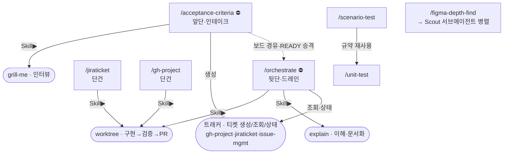

# `skills/` — 스킬 개요 & 호출 구조

이 폴더의 각 `*/SKILL.md`는 **"이 작업을 하면 이 절차를 따르라"**는 절차/노하우다(관련 작업이 올 때만 로드돼 컨텍스트를 가볍게 유지).
여기서는 **어떤 스킬이 있고, 누가 누구를 호출하는지**를 한눈에 본다. (개별 규칙·커스터마이징은 각 `SKILL.md` 참고)

## 두 레이어 — 오케스트레이터 vs 원자

- **오케스트레이터(조립) 스킬**: 스스로 밑작업을 하지 않고, **원자 스킬을 `Skill` 도구로 호출해 규칙대로 엮는다.** 상태는 스킬이 아니라 **보드/트래커(관제탑)** 에 둔다.
  → `acceptance-criteria`, `orchestrate`, (그리고 단건 워크플로 `jiraticket`·`gh-project`)
- **원자 스킬**: 한 가지 일만 잘한다. 혼자 써도 되고, 오케스트레이터가 블록처럼 끼워 쓴다.
  → `grill-me`, `worktree`, `explain`, `issue-mgmt`, `unit-test`, `scenario-test`, `figma-depth-find`, `make-plan`

---

## 호출 트리 (누가 누구를 부르나)

### 한눈에 — 레이어 & 의존 그래프

**진입점(사람이 호출)** 은 사각형, **원자 블록(호출당하는 공용 스킬)** 은 둥근 노드. 실선 `─▶`=`Skill` 도구 호출, 점선 `-.->`=보드 경유 인계.



**공용 원자 블록을 누가 부르나 (재사용 역방향):**
- `worktree` ← **orchestrate · jiraticket · gh-project** — 세 진입점이 공유하는 단 하나의 구현 엔진
- `트래커` ← **acceptance-criteria**(생성) · **orchestrate**(조회·상태 이동)
- `explain` ← **orchestrate** (직접 호출도)
- `grill-me` ← **acceptance-criteria** (직접 "grill me"도)

> **이중 역할 주의**: `gh-project`·`jiraticket`은 두 모자를 쓴다 — (1) 티켓 1개를 처리하는 **단건 워크플로 진입점**, (2) `acceptance-criteria`·`orchestrate`가 티켓 생성·조회·상태이동에 부르는 **트래커 블록**. 어느 트래커를 쓸지는 `CLAUDE.md`의 `service-kit:config`가 정한다.

### 흐름별 순서 (sequence) — 실제 실행 순서

#### ① 스펙 주도 자율 실행 루프 — 오케스트레이터 한 쌍 ⛔(사용 전 grill-me 고도화 필요)

```
/acceptance-criteria   (앞단 · 조립)   추상 요구 → 작은 티켓 + AC
   ├─ Skill▶ grill-me                  한 번에 한 질문 인터뷰로 구체화
   └─ Skill▶ 트래커(아래 중 1개)        티켓을 BACKLOG에 생성
                    │
        (사람이 READY로 옮김 = AC 승인 서명)
                    ▼
/orchestrate           (뒷단 · 조립)   READY를 Priority 순 자율 드레인
   ├─ Skill▶ 트래커(아래 중 1개)        READY 조회 · Status 이동(In progress/In review)
   ├─ Skill▶ worktree                  격리 구현 → 검증 → 커밋 → PR
   └─ Skill▶ explain                   변경의 구조·데이터흐름 서술(+실제로 돌려본 결과)
```
> **트래커는 중앙 config에서 자동 선택**: `CLAUDE.md`의 `service-kit:config`에 install.sh가 적어둔 값(`jira`→`jiraticket`, `ghproject`→`gh-project`, `none`→계획서만)을 읽는다.
> **⛔ 고도화 게이트**: 이 두 스킬은 설치 시 잠겨 나온다 — 첫 사용 전 **grill-me로 이 프로젝트에 맞게 고도화**(검증 레시피·Status 이름·큐 트리거 등)한 뒤 게이트 블록을 제거해야 실행된다.

#### ② 티켓 기반 단건 워크플로 — 루프 없이 하나만

```
/jiraticket   또는   /gh-project      티켓 1개 조회 → 코드 분석 → 구현 위임
   └─ Skill▶ worktree                  격리 구현 → 검증 → 커밋 → PR

issue-mgmt                             티켓 생성·상태전환·커밋 연결 "규칙"
                                       (다른 스킬/사람이 참조하는 절차 문서)
```

#### ③ 테스트

```
/unit-test          API(핸들러) 1개 단위 테스트  ─┐ 서로 규약·하네스 참조
/scenario-test      여러 API를 순서대로 부르는 유저 플로우 테스트 ─┘
```

#### ④ 디자인

```
/figma-depth-find   (또는 상위 스킬이 호출)
   └─ Scout 서브에이전트 병렬 → Figma 깊게 탐색 → 우리 코드베이스 컴포넌트로 매핑
```

#### 원자 스킬 한 줄 정의 (위에서 블록으로 불리거나, 혼자서도)

```
worktree   구현→검증→커밋→PR 메커니즘 (오케스트레이터·티켓워크플로가 공용으로 호출)
explain    AI가 짠 변경을 '참여'용으로 이해·문서화 (orchestrate가 호출 / 직접도)
grill-me   계획·설계를 한 번에 한 질문씩 파고드는 소크라테스 인터뷰 (Matt Pocock, MIT)
make-plan  plan·설계 문서를 "화면 → 설계" 순서의 시각적 형식으로 작성 (상위 스킬의 plan 단계가 호출 / 직접도)
```

---

## 스킬 개요 표

| 스킬 | 레이어 | 한 줄 | 발동 |
|---|---|---|---|
| **acceptance-criteria** | 오케스트레이터(앞단) ⛔ | 추상 요구를 grill-me 인터뷰로 티켓+AC로 분해해 트래커에 생성 | `/acceptance-criteria` |
| **orchestrate** | 오케스트레이터(뒷단) ⛔ | READY 티켓을 순차 자율로 드레인(구현→검증→PR→explain), 3지점만 큐잉 | `/orchestrate`·"Ready 돌려줘" |
| **jiraticket** | 오케스트레이터(단건) | Jira 티켓 조회·선택 → 분석 → worktree로 구현 | `/jiraticket`·자연어 |
| **gh-project** | 오케스트레이터(단건) | GitHub Projects 아이템 조회·선택 → 분석 → worktree로 구현 | `/gh-project`·자연어 |
| **worktree** | 원자 | git 워크트리 기반 수정→검증→커밋→PR (공용 구현 절차) | 상위 호출·`/worktree` |
| **explain** | 원자 | 변경/신규 코드를 결정·가정·파급까지 복원해 wiki에 문서화 | 자연어·상위 호출 |
| **grill-me** | 원자 | 한 번에 한 질문씩 결정 트리를 파고드는 인터뷰 | "grill me" |
| **issue-mgmt** | 원자(절차) | 티켓 생성·상태전환·커밋/브랜치/PR 연결 규칙 | 자연어 |
| **unit-test** | 원자 | API 1개를 실제 진입점+테스트 DB로 검증 + 이해 브리핑 | `/unit-test`·자연어 |
| **scenario-test** | 원자 | 여러 API를 순서대로 부르는 유저 플로우 통합 테스트 | `/scenario-test`·자연어 |
| **figma-depth-find** | 원자(서브) | 큰 Figma 프레임을 멀티에이전트로 탐색·우리 컴포넌트 매핑 | 상위 호출·`/figma-depth-find` |
| **make-plan** | 원자(서브) | plan·설계 문서를 "화면 → 설계" 순서의 시각적 형식(§0 화면·mermaid·결정 표)으로 작성 | 상위 호출·`/make-plan` |

⛔ = 설치 시 고도화 게이트가 걸려 나온다(첫 사용 전 grill-me 고도화 필요).

---

## 새 스킬 추가

`_templates/SKILL.md`를 `skills/<이름>/SKILL.md`로 복사해 채운다. frontmatter의 `description`이 트리거를 결정하므로 **"무엇을 + 언제"**를 구체적으로 쓰고, `skills-eval/cases.jsonl`에 긍정+하드네거티브 케이스를 추가해 라우팅을 검증한다.
